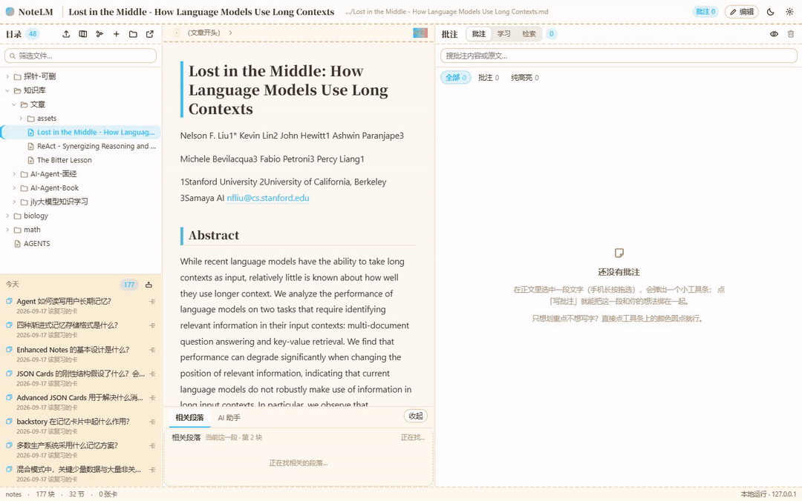
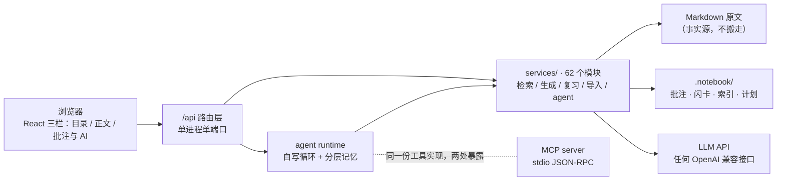

<div align="center">

# NoteLM

**本地优先的学习型笔记应用 —— 笔记原文就是你磁盘上的 Markdown 文件**

围绕你自己的原文做三件事：**读**（跨库检索与问答）、**学**（小抄 / 测验 / 间隔重复）、
**问**（一个能调用整个笔记库的本地 agent）。

[]()
[]()
[]()
[]()



*真实操作录制。左下「今天」栏把到期卡、复习计划、错题合并成一份行动清单，每行写明推荐理由；
点任意一行直接进入那张卡，翻面对答案（引文锚定回原文），打分后 SM-2 自动排期、队列前进。*

</div>

---

## 为什么是「本地优先」

多数 AI 笔记工具要么把你的内容搬进云端，要么 AI 生成结果和原文是两张皮。
NoteLM 反过来：**Markdown 文件是唯一事实源**，你可以随时用 Obsidian、VS Code 打开
同一个文件夹；软件只在旁边维护一份 `.notebook/` 伴生数据（批注、闪卡、AI 产物），
不改写你的原文。AI 生成的每一段内容都锚定回原文位置，源文件改了也能自动重新对齐。

## 功能

**阅读与批注**
- 选中一段文字即可批注，点批注卡跳回正文并高亮；五级降级定位，源文件被外部编辑后锚点自动贴回
- 乐观锁编辑，多窗口改动会提醒而不是互相覆盖
- 删除先进回收站（`.notebook/trash/`），误删可找回

**导入**
- Markdown / 纯文本：一键排版（合并硬折行、规范标题、中英文间距）
- PDF：按字号还原标题层级、识别代码块、剔除页眉页脚，位图插图导出到 `assets/`
- 飞书文档：走官方 API（图片必须带 token 取流，直接复制粘贴必丢图），导入即普通 Markdown
- 导出压缩包（飞书 / 语雀 / Notion）：ZIP 解压为手写实现，中文名自动识别 UTF-8 / GBK，Zip Slip 防线

**学习与复习**
- AI 生成小抄 / 章节测验 / 闪卡，全部带**覆盖度质量门**：对账不过的产物不进库
- SM-2 间隔重复排期；「今天」栏把到期卡、复习计划、错题合并成一份行动清单，每行写明推荐理由
- 复习队列动态组装：计划没排到的到期卡自动补入队首，点哪条就复习哪条

**检索与问答**
- 跨整个笔记库的语义检索（向量接口可选配）+ 关键词兜底（二元切分 + TF-IDF）
- 「问一句」模式：先检索片段，模型只依据片段作答，答案用 `[1] [2]` 标注来源、点编号跳原文
- 检索不到时明确说没有，不硬凑

**本地 agent 与 MCP**
- 自写 agent runtime（无框架）：工具调用循环 + 分层记忆（工作 / 语义 / 情景 / 程序 / 巩固）
- 工具集以只读为主，一份实现两处暴露：应用内 agent 与 MCP server 行为天然一致
- MCP 传输为手写 stdio JSON-RPC（约 80 行），`npm run mcp` 即可被任何外部 agent 挂载

**数学公式**：KaTeX 渲染，按块带锚点

## 快速开始

需要 Node.js 18+。

**方式一（Windows）**：双击 `启动.bat`。自动检查 Node、装依赖、起服务并打开浏览器。

**方式二**：命令行

```bash
npm install
npm run dev      # 开发：Vite HMR + 后端热重启，访问 http://127.0.0.1:3000
```

其他命令：

```bash
npm run build      # 类型检查 + 打包前端
npm run start      # 生产模式
npm run typecheck  # 只做类型检查
npm run mcp        # 起 MCP server（stdio），供外部 agent 调用
```

服务默认只绑 `127.0.0.1`。首次打开选一个文件夹当笔记库即可 —— **想先看看长什么样，
把目录指到 `examples/sample-library`**（一个干净的示例库，不需要 API Key 就能读、批注、看结构）。
AI 功能需要自己填 API Key（任何 OpenAI 兼容接口），不填也不影响阅读与批注。

## 架构



单进程单端口（Express 内嵌 Vite middleware），同源所以没有 CORS。
启动时生成一次性 token 注入 `index.html`，所有 `/api/` 请求都要带上，外部网页打不进来。

## 工程实现

<details>
<summary><b>推理模型的「思考」会吃掉正文的输出额度</b>（点击展开）</summary>

生成小抄时出现过诡异现象：同一段提示词，有时完整、有时尾部整段消失，且 HTTP 200 无报错。
查 `finish_reason` 才发现：推理模型的思考内容与正文**共享同一个 `max_tokens`**，
推理吃满额度时正文一个字都写不出来，故障是静默的。

| | 成功块数 | 正文 0 字 | 单块耗时 |
|---|---|---|---|
| 默认（思考开） | 4 / 21 | 14 次 | 30 ~ 35 s |
| `thinking: disabled` | **21 / 21** | 0 | **5 ~ 6 s** |

凡是写长 JSON / 长正文的调用点都显式关思考；需要推理的 agent 循环保持开启。

</details>

<details>
<summary><b>生成质量不能靠「读一遍」保证</b>（点击展开）</summary>

- **覆盖度质量门**：源块与生成结果双向对账，不达标的产物不进库
- **三层去重**：`exact`（逐字相同）/ `similar` / `subset` 分级，只有 `exact` 自动合并，
  近似重复交人工判断 —— 换个说法未必是冗余
- **锚点自愈**：批注锚定在源文本上，外部编辑后按五级降级重新对齐
- **回归集**：348 条带逐字引用的样本，只追加不覆盖（样本取自作者自己的笔记库，
  含原文引用，因此留在本地、不随仓库分发）；任何生成类改动先跑离线对照再合并

</details>

<details>
<summary><b>生成慢往往不是模型慢</b>（点击展开）</summary>

三层改法，每层都能单独关掉（关闭时行为逐字节不变）：

- 共享并发原语：三处各自实现的 `mapLimit` 收编为一个模块
- 全局 AI 并发闸：所有模型调用过一道闸（默认并发 3），避免并行化把接口打到限流
- 429 / 529 指数退避：`min(2000 × 2ⁿ + 抖动, 30s)`，最多三次

</details>

<details>
<summary><b>依赖边界：什么时候不装库</b>（点击展开）</summary>

能用标准库写完的不引第三方包，已经手写的：

| 功能 | 常见做法 | 这里的做法 |
|---|---|---|
| ZIP 解压 | `adm-zip` 等 | 手写 deflate + stored，中文名识别 UTF-8 / GBK，Zip Slip 防线 |
| HTML → Markdown | `turndown` | 手写转换器 + SSRF 三步校验（含字面量 IP 跳过 `dns.lookup` 等 Node 网络栈的坑） |
| MCP 协议 | 官方 SDK | 手写 stdio JSON-RPC 约 80 行，协议变更只落适配层 |
| agent 循环 | LangGraph 等 | 自写 runtime + 五层记忆 |

判断标准不是「轮子好不好」，而是**这一层会不会变**。
安全性：写工具只有两个（批注回复、网页入库），其余全库只读；
API Key 只写不读，服务端从不返回明文。

</details>

## 目录结构

```
src/                 前端（React 18）
  components/        三栏界面、复习房间、树面板
  lib/               排版 / Anki 导出等纯函数
server/              后端（Express + Vite middleware，单进程）
  routes/            /api 路由
  services/          62 个业务模块（检索 / 生成 / 复习 / 导入 / agent）
  mcp.ts             MCP server（stdio JSON-RPC）
shared/              前后端共用的解析与渲染
scripts/
  probes/            验证探针（离线可复放：锚点跟随、拆分守恒、质量门、去重阈值、MCP 协议）
  tools/             数据处理工具（索引重建、覆盖度统计、题库整理、批量生成）
examples/
  sample-library/    示例笔记库（干净、可直接拿来跑）
deploy/deploy.sh     云上一键部署脚本
docs/arch/           交互式架构图（HTML，浏览器直接打开）
docs/screenshots/    操作演示
```

## 部署到服务器

`deploy/deploy.sh` 面向 Alibaba Cloud Linux 3 / CentOS 8 系：
装 Node、拉代码、构建、写 systemd 服务、配每日备份（保留 14 天）。

```bash
sudo APP_DIR=/opt/notelm PUBLIC_HOST=<你的公网 IP 或域名> bash deploy/deploy.sh
```

`PUBLIC_HOST` 必填 —— 脚本用它做 Host 白名单校验，不填公网访问一律 403。
2G 内存的小机会自动开 2G swap（pdfjs 解析大 PDF 的峰值内存会到 500MB 以上）。

## License

[MIT](LICENSE)
